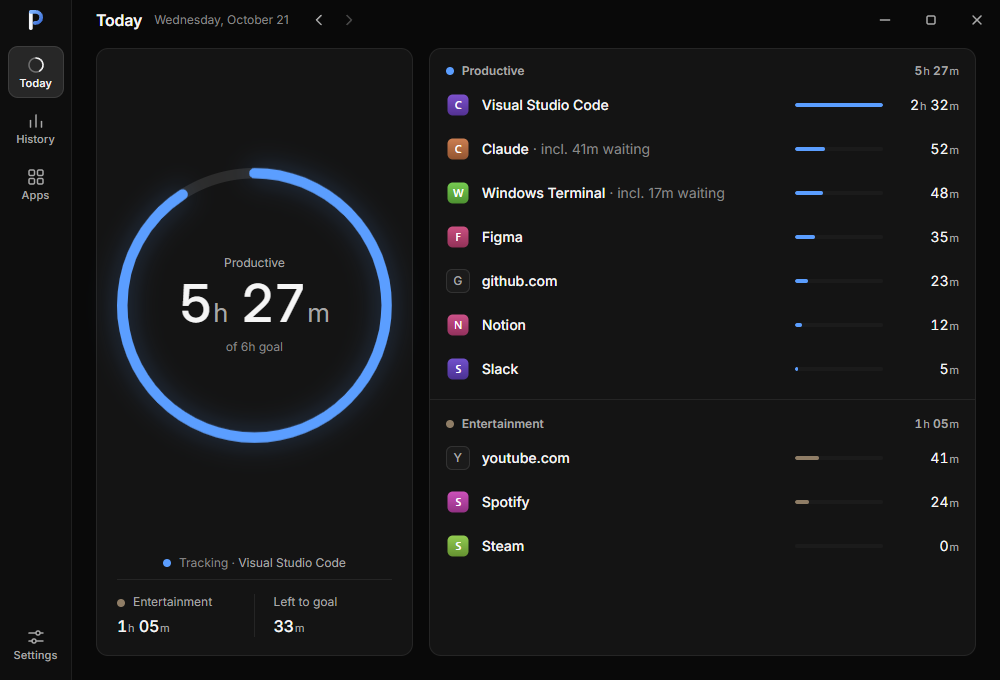
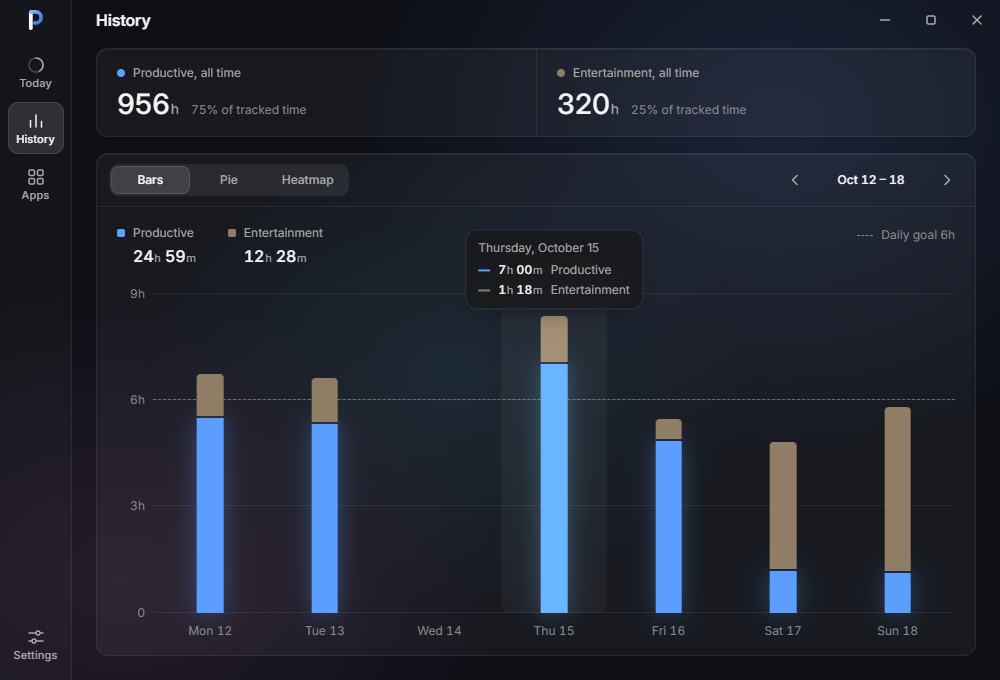
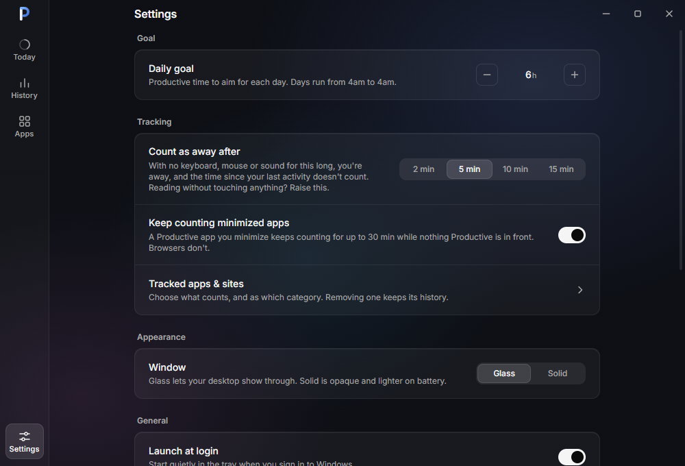

<!-- "Productivity Tracker" is a working name. To rename, search the repo for "Productivity
Tracker", "ProductivityTracker" and "productivity-tracker". The user-facing places are this file,
LICENSE, productName and identifier in src-tauri/tauri.conf.json, APP_DIR_NAME in
crates/tracker-api/src/lib.rs (the data folder; changing it orphans existing data), index.html,
src/components/{TitleBar,Rail}.tsx, the startup error dialog in src-tauri/src/lib.rs, the export
file name in src-tauri/src/commands.rs, and the <title> of the logo SVGs in src-tauri/icons/source
(then `bun run icons`). Renaming the GitHub repo also moves the updater's endpoint in
tauri.conf.json and REPO in scripts/release.mjs. -->

#  Productivity Tracker

An automatic time tracker for Windows that only counts what you opt in to. You pick which apps and sites are Productive and which are Entertainment. Nothing else is tracked, and your data never leaves your PC.

No timers to start, no account, no cloud. It sits in the tray, starts at login, and shows how much real work you did today, this week and this year.

<p>
  
</p>
<p>
  
</p>
<p>
  
</p>

The screenshots use mock data.

## How it counts time

Once a second the tracker decides whether that second counts, and for what. Every second counts once, for at most one thing, in this order:

1. A Productive app or site in front.
2. Otherwise, a Productive app you minimized in the last 30 minutes, so an agent or a render you're waiting on still counts. Browsers never do, since a minimized browser is usually a video or music. This needs Settings → "Keep counting minimized apps", which is off by default for new installs.
3. Otherwise, whatever is in front, if you track it.

An app or site you haven't picked counts for nothing. A tracked site always beats its browser. If you track the browser too, other sites count as the browser's category.

You have to be there for time to count:

- After a stretch with no keyboard, mouse or sound from the app in front, you're away, and the time back to your last activity is removed. The stretch is 5 minutes by default, and Settings offers 2, 5, 10 or 15. A 40-minute video you watch without touching anything still counts in full, because its sound shows you're there.
- An AI agent or a render you watch work in front, without touching anything, can keep counting too. Turn on "Counts while I watch" in the app's popover in Apps & sites; it's offered for Productive apps that aren't browsers, and it's on by default for the Claude, ChatGPT/Codex and T3 Code desktop apps. While that app is in front, you stay active for up to 30 minutes after your last input or sound. After 30 minutes you're away, and only the time past those 30 minutes is removed. Today's status line reads "Tracking · T3 Code · watching" meanwhile. If you walk away from a watched app, it can count up to 30 minutes you weren't there for, so lock the PC (Win+L) when you leave.
- Sound alone keeps you active for at most 2 hours. After that, time trims back to your last real input, so a film left playing to an empty room counts nothing.
- Screen lock, sleep, display off and a disconnected session never count.
- Xbox-style game controllers count as input.

Days run from 4am to 4am, so work at 1:30am still belongs to the day before.

To stop counting for a while, use Pause in the tray menu: 15 minutes, 1 hour, or until tomorrow, which means the next 4am. A pause survives a restart and ends on its own.

Changing an app's category changes future time only. Past days keep the category they had.

## Install

Windows 10 or 11, 64-bit.

1. Download the `ProductivityTracker_<version>_x64-setup.exe` installer from the [latest release](https://github.com/rithwik1510/productivity-tracker/releases/latest).
2. Run it. It installs for your user only and doesn't need admin rights.
3. The installer isn't code-signed yet, so Windows SmartScreen may say "Windows protected your PC". Click **More info**, then **Run anyway**. Signed builds are planned.

The app uses Microsoft Edge WebView2 to draw its window. Windows 11 ships with it. If it's missing, which happens on some Windows 10 PCs, the installer downloads it from Microsoft.

On first run you tap the apps you work in, then the ones that are for fun, then set a daily goal. After that, closing the window keeps tracking in the tray. Open it again from the tray icon.

### Updates

From v0.1.2 on, the app updates itself from this repository's GitHub releases. It checks a few seconds after it starts and every 6 hours while it runs, and downloads a new version in the background. Nothing restarts on its own: the Day view says "Update ready · v0.1.3 · Restart", and the tray menu has "Restart to update". Restarting saves the time counted so far, runs the installer with a progress bar and no questions, and opens the app again on the new version. Each update's installer is signed, and the app refuses one whose signature doesn't match.

Settings → About has "Check for updates" and the "Check for updates automatically" switch. To upgrade from v0.1.0 or v0.1.1, install v0.1.2 or later by hand once, over the old version. Your data stays.

## Privacy

Everything stays on your PC. There's no account, no telemetry and no crash reporting. The only thing the app asks the internet for is updates (see Network).

### What it reads while running

- Which window is in front and which program owns it, by exe file name such as `discord.exe`, or by AppUserModelID for Store apps. For a `chrome.exe`, also the product name in its file properties, to tell Helium or Chromium from Google Chrome.
- The title of that window. It stays in memory and is only matched against the title keywords of sites you track. Titles are never written to disk.
- In Chrome and its forks, Edge, Brave, Thorium and Comet, the address bar text, through Windows UI Automation. The tracker keeps only the host name, such as `youtube.com`, and drops the rest of the address right away. It reads the browser's toolbar and never the page. The same read tells a private window from a normal one.
- Whether the app in front is making sound, from the peak level of each audio session. This is only a sign that you're there. No audio is recorded.
- How long ago the last keyboard, mouse or controller input happened. Not which keys, and not where the mouse is.
- Lock, unlock, sleep, display-off and session-disconnect events.
- Which apps have a minimized window, for "Keep counting minimized apps".
- When you open the app picker, your Start Menu apps and running windows, so it can list them with their icons.

### What it stores

All of it lives in `%LOCALAPPDATA%\ProductivityTracker`:

- `tracker.db`, a SQLite database with:
  - the apps you've tracked: exe name or AppUserModelID, display name, category, and whether it counts while you watch;
  - the sites you've added: domain, title keyword, category;
  - time intervals: start, end, which tracked app or site, its category then, and whether it was minimized-app time;
  - your settings.
- `icons\`, icon images for the apps the picker lists, so it opens quickly. That includes installed apps you haven't tracked.
- `logs\`, startup messages and errors, kept for 7 days. They don't contain window titles, sites or what you were doing.
- `webview\`, the WebView2 profile for the app's window.

### What it never stores

- Window titles, full URLs or page paths, or anything from inside a web page.
- Keystrokes, mouse positions or audio.
- Time in apps you haven't tracked, or on sites you haven't added.
- Anything from a private window: Incognito, InPrivate or Private Browsing. See Known limits for how it tells.

### Network

The update check is the app's only network request. A few seconds after start and every 6 hours, it makes a normal HTTPS request to GitHub for `latest.json`, the small file that names the newest release. When that is newer than the installed version, it downloads the installer from GitHub too. Nothing about your usage, apps, sites or settings is sent. Like any web request, GitHub sees your IP address and the updater's user agent.

To turn it off, switch off Settings → About → "Check for updates automatically". The app then makes no network requests at all, unless you press "Check for updates".

The update check runs in the Rust side, which has no other networking code. The window's Content Security Policy only allows the app's own local files and its IPC channel (`connect-src ipc:`), so the page can't reach the internet. WebView2 itself is Microsoft's runtime, which Windows installs and updates.

Exports only go where you save them. Settings → Delete all data erases your history, tracked apps and sites, settings and icons, and returns the app to first run. It leaves `logs\` and `webview\` in place.

To see exactly what the tracker reads each second, run the probe CLI from source: `cargo run -p tracker-win --features probe --bin tracker-probe -- --help`.

## Supported browsers

| Browser | How the site is read |
|---|---|
| Google Chrome, Chromium forks that ship as `chrome.exe` (Helium, Chromium, ungoogled-chromium, Supermium), Microsoft Edge, Brave, Thorium, Comet | Address bar, falling back to the window title |
| Vivaldi, Opera | Window title only |
| Firefox, Zen, LibreWolf, Waterfox, Floorp | Window title only |

Arc isn't supported yet.

Window-title matching uses each site's title keyword, which defaults to the domain's first label, such as `youtube`. You can edit it in the site's popover.

## Known limits

- Windows only.
- Private-window detection depends on the browser's English UI text: "(Incognito)" in Chrome, "(Private)" in Brave, "Private Browsing" in Firefox and its forks. With another UI language those windows may count as normal ones. Edge's "[InPrivate]" marker is a brand name and should hold in any language.
- Private windows in Vivaldi and Opera aren't detected.
- In Chrome, Edge, Brave, Thorium and Comet, a window counts nothing until the tracker has read whether it's private. Chrome's window title doesn't say, so a window whose first read fails or is slow counts as private, for about 10 seconds at a time, until a read works. If UI Automation is broken on the PC, those browsers count nothing at all.
- If the database can't be written (a full disk, say), the Day view and the tray say "Can't save, retrying". Time in that spell isn't counted, and tracking picks up once a write works.
- Firefox and its forks, Vivaldi and Opera report the site from the window title only. A page whose title doesn't mention the site doesn't count as that site.
- In fullscreen, a browser hides its address bar, so the tracker falls back to the title there too.
- Only the window in front counts. A video playing on a second monitor doesn't count unless its window is the one in front.
- Each game is its own app. Tracking Steam or another launcher doesn't cover the games it starts, so pick the games themselves.
- Programs that share one runtime exe, such as `javaw.exe` or `python.exe`, count as one app.
- Chromium forks that ship as `chrome.exe`, such as Helium, are apps of their own, told apart by the product name in the exe's file properties. Time a fork recorded before the tracker told them apart stays under Google Chrome.
- The same app installed from the Store and from a normal installer counts as two apps.
- Minimized-app time needs the window minimized to the taskbar. Apps that hide to the tray, windows behind others, and windows on another virtual desktop don't get it.
- Only Xbox-style (XInput) controllers count as input. A PlayStation pad counts only through Steam Input.
- Today's number can drop by a few minutes when you go idle, once the away rule trims the idle tail. The Day view then says how much it removed, such as "Away · removed 6m idle time".
- Days use your current time zone, so after travel, past days are re-bucketed.

## Uninstall

Use Windows Settings → Apps → Installed apps → Productivity Tracker → Uninstall. This removes the app and its launch-at-login entry.

Your data folder stays at `%LOCALAPPDATA%\ProductivityTracker`, so a reinstall picks up your history. The uninstaller's "Delete the application data" checkbox doesn't reach it. To remove your data:

- Before uninstalling, use Settings → Delete all data, or
- After uninstalling, delete the folder. Paste `%LOCALAPPDATA%` into the Explorer address bar and delete `ProductivityTracker`, or in PowerShell run:

  ```powershell
  Remove-Item -Recurse -Force "$env:LOCALAPPDATA\ProductivityTracker"
  ```

## Build from source

You need Windows 10 or 11 with:

- [Rust](https://rustup.rs/), stable, MSVC toolchain, with the Visual Studio C++ build tools
- [Bun](https://bun.sh/)
- WebView2, already on Windows 11

```sh
bun install
bun run tauri dev      # the app, with a dev build of the tracker
bun run tauri build    # release build and NSIS installer, in target/release/bundle/nsis/
```

`bun run dev` alone serves only the UI at http://localhost:1420 with mock data, in any browser.

A dev build uses the same data folder as an installed copy, and only one copy runs at a time. Quit the installed app from the tray first. Dev builds never touch launch at login.

Checks:

```sh
bun run check                                   # Biome lint and format
bun run typecheck
bun run e2e                                     # Playwright on the mock UI, needs Microsoft Edge
cargo fmt --all --check
cargo clippy --workspace --all-targets -- -D warnings
cargo test -p tracker                           # tracking scenarios
bun run bindings                                # regenerate TypeScript bindings after changing commands
bun run icons                                   # regenerate every app and tray icon from src-tauri/icons/source
```

`bun run release` builds a signed installer and its `latest.json` for the auto-updater. It needs the updater's private key, which only the maintainer has. A build from source uses `bun run tauri build` instead; once installed, it checks GitHub for the official releases like any other copy.

The code is a thin Tauri v2 shell in `src-tauri/` around three Rust crates:

- `crates/tracker-api`, shared types
- `crates/tracker`, the engine, SQLite store and day math, with no Windows code
- `crates/tracker-win`, the Windows adapters

The UI is React and TypeScript in `src/`. `GLOSSARY.md` defines the terms used across the code, and `docs/adr/` records the design decisions.

## License

[MIT](LICENSE)
